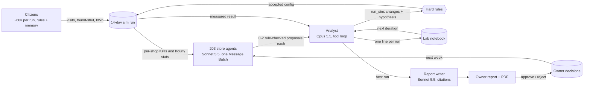

# Agent design

How the Smart City Sim agents plan, hand off work, remember, how long they run, what they cost,
and how they recover when something fails. For judges and the team. Code: `backend/agents/`,
`backend/llm.py`, `backend/chaos.py`. Every recovery below has a test you can run:
`uv run pytest -q tests/test_resilience_*.py tests/test_chaos.py`.

## The agents

| Agent | How many | Model | What it does | When Claude is unavailable |
| --- | --- | --- | --- | --- |
| Citizens | about 59,800 per 14-day run on the current map (about 4,300 a day) | none (rules, seeded) | Arrive by persona, walk Shoreditch, visit or find shops shut, remember shut shops for 14 days | not an LLM |
| Shop owners in the sim | 209 venues | none (rules) | Adapt their own hours day by day inside a run (`backend/sim/owners.py`) | not an LLM |
| Store-owner agents | 203 (one per non-club shop) | Claude Sonnet 5.5, Message Batches, structured outputs | Read only their own shop's data and propose 0-2 changes to hours or lighting | the deterministic heuristic in `store_owner.py` |
| Analyst (orchestrator) | 1 | Claude Opus 5.5, tool use, adaptive thinking (or a Managed Agents session) | Plans each experiment, picks which proposals to test, runs the sim as a tool, reflects in the lab notebook | `HeuristicAnalyst`, same tools and rules |
| Report writer | 1 call per shop per session | Claude Sonnet 5.5 with citations | Words each owner's weekly report from the measured numbers | a template |
| Persona extraction | once, in the data pipeline | Claude Haiku 5.5 | Turns sourced documents into citizen personas | cached response |

Every LLM agent has a deterministic fallback with the same inputs and outputs, so the system never
needs Claude to finish a session. Claude makes the choices better; it is not a single point of
failure.

## Who plans, and how: plan, propose, test, reflect

`backend/agents/training.py` owns the loop; each step is checkpointed to
`runs/analyst_state.json` before the next begins.

1. **Baseline** (`start` to `baseline`): simulate 14 days with every shop's current settings.
2. **Propose** (`proposed`): the analyst hands the best run to the store agents. All 203 run as
   one Message Batch; each sees only its own shop plus public area data (the data firewall).
   Every proposal passes the hard rules (`rules.py`: licensed hours, 30-minute grid, at most two
   changes a week, never a config already tried, clubs never change).
3. **Plan and choose** (`chosen`): the analyst reads the notebook, the last measured result and
   the proposals with their expected area gain, checks options with `propose_config`, and commits
   one experiment with `run_sim(changes, hypothesis)`. The rules re-check the choice.
4. **Test** (`ran`): the sim runs the best config plus the chosen changes on the same seed.
5. **Reflect** (`scored`): the objective is compared with the best run; the notebook gets one
   measured line ("Opened Kebab Co till 03:00 → +18% night visits"); the best run moves forward
   or the low-gain streak grows.
6. **Stop**: gain under the threshold for `patience` runs, nothing left to try, `maxRuns`, the
   spend cap, or a stop request. Then the wrap-up: next week's proposals on the best run, one
   owner report per shop, the session's cost on every run.

## Hand-offs



Every hand-off is an event in the agent log (`GET /api/agents/log`): `handoff`, `proposals`,
`hypothesis`, `tool_call`, `experiment`, `result`, and every error and recovery below.

## Memory

- **Lab notebook** (`runs/notebook.json`, and a Managed Agents memory store for that backend): one
  measured line per run, read by the analyst at every iteration. A fresh analyst conversation per
  iteration is seeded from it, so a restart loses nothing.
- **Owner decisions** (`runs/decisions.json`): each approve or reject goes back to that shop's
  agent next week; a rejected change is never proposed again.
- **Config history**: each store agent sees its own shop's last 8 configs and their KPIs.
- **Citizen memory**: a returning citizen who found a shop shut remembers it per 3-hour band and
  avoids it for the rest of the 14 days.
- **Run cache** (`runs/cache.json`): every simulated config, so no experiment is paid for twice.

## How long it runs (measured today)

Measured on the current map (1.5 km, 209 venues, 203 shops, about 59,800 citizens per run) with
the offline backends, on a laptop that was also running other jobs (load average 22 to 25):

| What | Time |
| --- | --- |
| One 14-day run, cold process | 16.5 s of simulation (17 s wall) |
| One run inside a session | 19 to 24 s |
| One offline session: baseline + 2 experiments, stopped on the threshold, then reports for 203 shops with 2 extra-seed checks per report | 2 min 28 s wall |
| Chaos demo: 3 runs through the online code paths (fake Claude) under heavy faults, with reports | 2 min 9 s |

A live session adds the Claude calls: one Message Batch for the 203 store agents per iteration
(minutes; after `BATCH_TIMEOUT_SECONDS`, 2 h by default, the missing shops go per request) and a
few analyst turns. A 10-run session runs unattended for tens of minutes to a few hours,
checkpointed after every step.

## What it costs

From the cost ledger (`runs/costs.jsonl`, session 58ab54fb42ce, `docs/PMF.md` 6.4), measured on
the earlier 24-shop map: one live iteration with reports cost USD 0.3564 over 50 calls: the Opus
analyst USD 0.0737 (2 calls), 24 batched Sonnet store agents USD 0.1379, and 24 Sonnet reports
USD 0.1448.

Derived for today's 203 shops (store agents and reports scale with shops): about USD 1.24 per
run (analyst 0.07 + store agents 1.17) and USD 1.22 for the reports once per session, so a
10-run session is about USD 13.6, under the USD 15 session cap. The cap is a hard ceiling: every
call is pre-flighted at its worst case, and a batch only carries the shops whose worst case
(prompt as uncached input plus the full 8,000-token output) still fits: USD 8.66 for all 203
shops, so late in a session some shops get the heuristic instead of a call that could cross the
cap. Raise `sessionBudgetUsd` (up to USD 30) to keep every shop on Claude.

## Failure modes and recovery

Every error, retry, fallback and recovery is an event in the agent log with `kind`, `step`,
`attempt`, `wait` and `outcome`, and a count in `GET /api/agents/session` → `recoveries`
(`retries`, `fallbacks`, `repairs`, `skipped`, `resumed`, `quarantined`, `restored`, `errors`,
`breakerOpens`, `batchTimeouts`, `lockTakeovers`, `reconciled`).

**One retry policy** (`llm.call_with_retries`) wraps every Claude call: exponential backoff with
full jitter (1 s base, 30 s max wait), the server's `retry-after` honoured, at most 5 attempts and
120 s of waiting. The SDK's own retries are off, so nothing retries twice. **Circuit breaker**:
6 failed attempts in a row (or one auth error) and every agent uses its heuristic for the rest of
that step; it closes again at the next step.

| Failure | Where it can happen | Before | Now | Test |
| --- | --- | --- | --- | --- |
| 429 rate limit, 529 overloaded, 5xx, 408/409 | any Claude call | SDK default retries, then the session stopped with an error (analyst) or all shops fell back | retried with backoff and jitter, `retry-after` honoured, capped in attempts and time | `tests/test_resilience_llm.py::test_a_rate_limit_is_retried_then_succeeds_and_each_retry_is_logged`, `::test_retry_after_is_honoured`, `::test_total_retry_time_is_capped` |
| Timeout, connection reset | any Claude call | as above | retryable, same policy | `tests/test_resilience_llm.py::test_errors_are_classified_retryable_or_fatal` |
| Auth or permission error | any Claude call | session stopped | fatal: no retry, breaker opens, heuristics carry the session | `tests/test_resilience_llm.py::test_a_fatal_error_opens_the_breaker_at_once`, `tests/test_chaos.py::test_a_fatal_auth_error_degrades_the_whole_session_to_the_heuristics` |
| Claude down for a whole step | analyst, store agents, reports | session stopped (analyst) | breaker opens, heuristic for the rest of the step, `fallback` event, session goes on | `tests/test_resilience_agents.py::test_the_analyst_degrades_to_the_heuristic_when_claude_stays_down`, `::test_an_open_breaker_skips_claude_for_the_rest_of_the_step`, `::test_a_batch_api_outage_degrades_every_store_to_the_heuristic`, `tests/test_agents_report.py::test_wording_retries_an_overload_then_uses_the_template_when_claude_stays_down` |
| Batch partly failed (errored, expired, cancelled results) | store agents | those shops got the heuristic | those shops are asked again per request; heuristic only if that fails too | `tests/test_resilience_agents.py::test_partial_batch_failures_are_retried_per_request_for_those_stores_only`, `::test_a_store_whose_retry_also_fails_gets_the_heuristic` |
| Batch stuck `in_progress` | store agents | waited 2 h, then all heuristic | poll timeout, cancel, per-request calls for the missing shops | `tests/test_resilience_agents.py::test_a_stuck_batch_times_out_and_the_missing_stores_go_per_request` |
| Batch results expired | store agents | API error, all heuristic | per-request calls | `tests/test_resilience_agents.py::test_expired_batch_results_fall_back_per_request` |
| Process killed while a batch runs | store agents | resume submitted and paid a second batch | the batch id is recorded right after submitting; a resume re-attaches | `tests/test_resilience_agents.py::test_a_batch_submitted_before_a_kill_is_reattached_not_paid_twice` |
| Structured output fails validation (bad JSON, missing fields, empty) | store agents | that shop got the heuristic | one repair re-ask with the validation error; a second bad answer skips that shop only; an outage during the repair gives it the heuristic | `tests/test_resilience_agents.py::test_bad_json_gets_one_repair_with_the_validation_error`, `::test_output_that_fails_the_schema_is_repaired_once_then_the_shop_is_skipped`, `::test_a_repair_that_cannot_reach_claude_gives_that_shop_the_heuristic` |
| Refusal or `max_tokens` | store agents, analyst, reports | heuristic or template | same, now logged and counted as a `fallback` with its `kind` | `tests/test_resilience_agents.py::test_a_refusal_falls_back_to_the_heuristic_for_that_shop` |
| Empty answer, no `run_sim` | analyst | nudge once, then heuristic | unchanged | `tests/test_resilience_agents.py::test_an_empty_answer_is_nudged_then_falls_back` |
| Proposal breaks a hard rule | store agents, analyst, owner apply | rejected and logged | unchanged: rules run on every proposal and again on the analyst's choice | `tests/test_agents_rules.py` |
| Budget reached mid-step | any Claude call | checked against spend so far, so one call could cross the cap | pre-flight worst-case estimate (prompt + `max_tokens`) before every call; a batch carries only the shops that fit (the rest get the heuristic); stops cleanly with `stoppedReason: "budget"` and resumes at that step | `tests/test_resilience_agents.py::test_preflight_refuses_a_call_that_could_cross_the_cap`, `::test_a_batch_only_carries_the_shops_the_budget_can_cover`, `tests/test_resilience_training.py::test_a_budget_hit_mid_step_stops_cleanly_and_resumes_at_that_step` |
| Sim crashes mid-run | training | session stopped with an error | retried once into the same run id; a second crash quarantines the run (status `failed`, `error.json`, files kept) and the session moves on | `tests/test_resilience_training.py::test_a_transient_sim_crash_is_retried_and_the_session_is_unchanged`, `::test_a_run_that_keeps_crashing_is_quarantined_and_the_session_moves_on` |
| NaN or infinite objective, zero visits, outlier (gain above 300%) | training | scored as if valid | rejected with the reason in the notebook, quarantined, never reused | `tests/test_resilience_training.py::test_runs_that_fail_a_sanity_guard_are_quarantined_with_the_reason` |
| Unusable baseline | training | scored as if valid | stops with a clear error | `tests/test_resilience_training.py::test_an_unusable_baseline_stops_the_session_with_a_clear_error` |
| SIGKILL at any checkpoint | training | resumed; a kill mid-run could leave a duplicate run | intent before acting (run id reserved in `runs/training_intent.json`), completion after; resume gives exactly the uninterrupted result | `tests/test_chaos.py::test_a_trainer_killed_at_every_step_boundary_resumes_to_the_same_result`, `tests/test_resilience_training.py::test_a_kill_mid_simulation_resumes_into_the_same_run_id` |
| Corrupt or half-written checkpoint, notebook, index, decisions, run cache | storage | crash on load | fsync'd atomic writes; the last good copy kept as `.bak`; a bad file is restored from it (`restore` event) | `tests/test_resilience_files.py::test_a_corrupt_checkpoint_is_recovered_from_the_backup`, `::test_a_corrupt_notebook_and_index_recover_their_last_good_copy` |
| Half-written run files | storage | a run with a damaged summary could be reused | reused only when `summary.json` is readable, else simulated again | `tests/test_resilience_files.py::test_a_run_with_a_corrupt_summary_is_not_reused_from_the_run_cache` |
| Disk full on write | storage | could leave a temp file | the old file stays, the temp file is removed, the error surfaces | `tests/test_resilience_files.py::test_a_full_disk_leaves_the_previous_file_and_no_temp_files` |
| Two trainers at once | CLI and API | second refused (flock) | unchanged, plus a heartbeat file naming the holder | `tests/test_resilience_session.py::test_two_trainers_started_together_never_both_run` |
| Trainer killed, lock left behind | CLI and API | the kernel released the lock | taken over and logged (`lock_takeover`, with the dead process's heartbeat) | `tests/test_resilience_session.py::test_a_lock_left_by_a_killed_trainer_is_taken_over_and_logged` |
| Stale `running` after a crash, or API restart under a session | API | the UI showed a ghost session for up to 30 min | reconciled to `stopped` (`error`, resumable) on API startup and on read, only when no live process holds the lock | `tests/test_resilience_session.py::test_reconcile_marks_a_dead_running_session_stopped`, `::test_the_api_reconciles_on_startup_and_serves_recovery_counts` |
| Clock skew | API | a future timestamp read as running | the lock decides liveness; a future timestamp without a live holder is reconciled | `tests/test_resilience_session.py::test_a_checkpoint_from_a_clock_far_ahead_is_still_reconciled`, `::test_store_optimize_trusts_the_lock_over_timestamps` |

## Chaos testing

`backend/chaos.py` injects faults through the seams the agents already have, seeded and off unless
`CHAOS` is set:

```
CHAOS="llm_429:0.3,llm_timeout:0.1,bad_json:0.2,batch_stuck:0.3,sim_crash:0.05,kill_after_step:3"
CHAOS_SEED=7
```

Transport faults (`llm_429`, `llm_529`, `llm_500`, `llm_timeout`, `llm_conn`, `llm_auth`) are
raised inside the retry policy as the SDK would raise them. Answer faults (`bad_json`, `refusal`,
`empty`, `batch_stuck`, `batch_partial`) come from the fake Claude client (`backend/fake_llm.py`,
`FAKE_LLM=1`), which runs the online code paths end to end with no key and no spend. Sim faults
(`sim_crash`, `sim_nan`, `sim_zero`) wrap the runner. `kill_after_step:N` SIGKILLs the trainer
after its Nth checkpoint.

- `tests/test_chaos.py::test_a_session_under_heavy_chaos_finishes_with_a_valid_best_run`: 13
  fault kinds at once, 3 seeds; every session stops normally with a finite, non-quarantined best
  run, no duplicate or dangling runs, and reports for every shop.
- `tests/test_chaos.py::test_a_trainer_killed_at_every_step_boundary_resumes_to_the_same_result`:
  a real trainer process SIGKILLed after each of its 16 checkpoints in turn, then resumed; the
  final runs, notebook, run index, run folders, ledger calls and spend equal an uninterrupted
  session's.
- `uv run python -m backend.cli chaos-demo` runs a short session on the real map under faults in
  a new temp runs folder (never `runs/`) and prints faults injected, recoveries and who recovered
  from what. Measured today on the current map (`--max-runs 5 --seed 3`, 2 min 9 s): 166 faults
  injected (90 rate limits, 28 timeouts, 22 broken JSON answers, 3 stuck batches...); 124
  retries, 648 fallbacks (most of them shops handed to the heuristic while the breaker was
  open), 22 repairs, 3 breaker openings, 3 batch timeouts. The session still stopped normally
  (threshold) with a better best run: 0.4869 visits per kWh against the baseline's 0.4848. An
  earlier run on the 72-venue map also quarantined a NaN run and carried on.

## Not covered

- The Managed Agents analyst backend does not go through the retry policy or the breaker: an API
  error there stops the session with an error, and a restart resumes it. It has never run
  against the live API (see `analyst.py`). The default `messages` backend is fully covered.
- The run files of a past run that are damaged after it was scored (not by a crash mid-write) are
  not repaired; the run cache stops reusing it.
- Liveness relies on `flock`, which network filesystems may not honour; the heartbeat file names
  the holder but does not replace the lock.
